

  <picture>
    <source media="(prefers-color-scheme: dark)" srcset="assets/banner-dark.svg">
    
  </picture>

  <a href="https://www.linkedin.com/in/samanbha-dylan-pariat-945394215/">
    <picture>
      <source media="(prefers-color-scheme: dark)" srcset="assets/linkedin-dark.svg">
      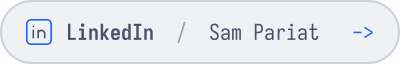
    </picture>
  </a>

  <picture><source media="(prefers-color-scheme: dark)" srcset="assets/summary-dark.svg">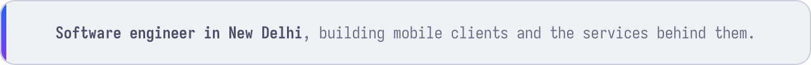</picture>

  <a href="#experience"><picture><source media="(prefers-color-scheme: dark)" srcset="assets/nav-experience-dark.svg">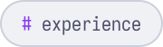</picture></a>
  <a href="#stack"><picture><source media="(prefers-color-scheme: dark)" srcset="assets/nav-stack-dark.svg">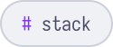</picture></a>
  <a href="#featured"><picture><source media="(prefers-color-scheme: dark)" srcset="assets/nav-featured-dark.svg">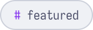</picture></a>

## Experience

<picture>
  <source media="(prefers-color-scheme: dark)" srcset="assets/experience-dark.svg">
  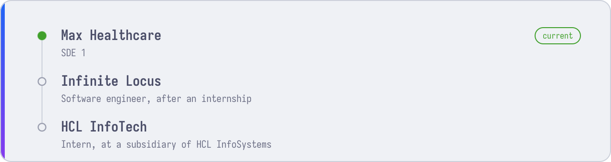
</picture>

## Stack

<picture>
  <source media="(prefers-color-scheme: dark)" srcset="assets/stack-dark.svg">
  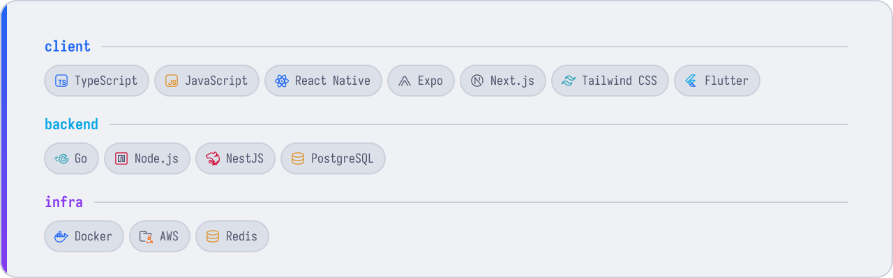
</picture>

## Featured

<a href="https://github.com/SamPariat/roundup">
  <picture>
    <source media="(prefers-color-scheme: dark)" srcset="assets/roundup-card-dark.svg">
    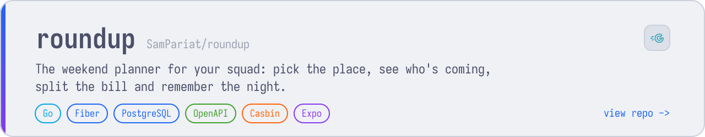
  </picture>
</a>

<a href="https://github.com/SamPariat/roundup-ui">
  <picture>
    <source media="(prefers-color-scheme: dark)" srcset="assets/roundup-ui-card-dark.svg">
    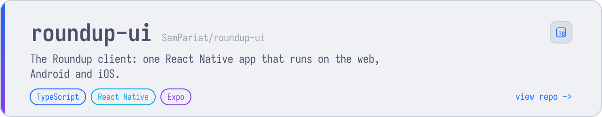
  </picture>
</a>

<a href="https://github.com/SamPariat/movie-recommendation-sm">
  <picture>
    <source media="(prefers-color-scheme: dark)" srcset="assets/cinesuggest-card-dark.svg">
    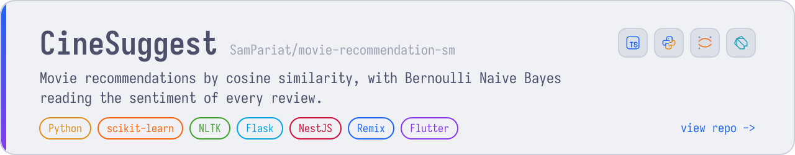
  </picture>
</a>

Set in Iosevka · Catppuccin Macchiato

